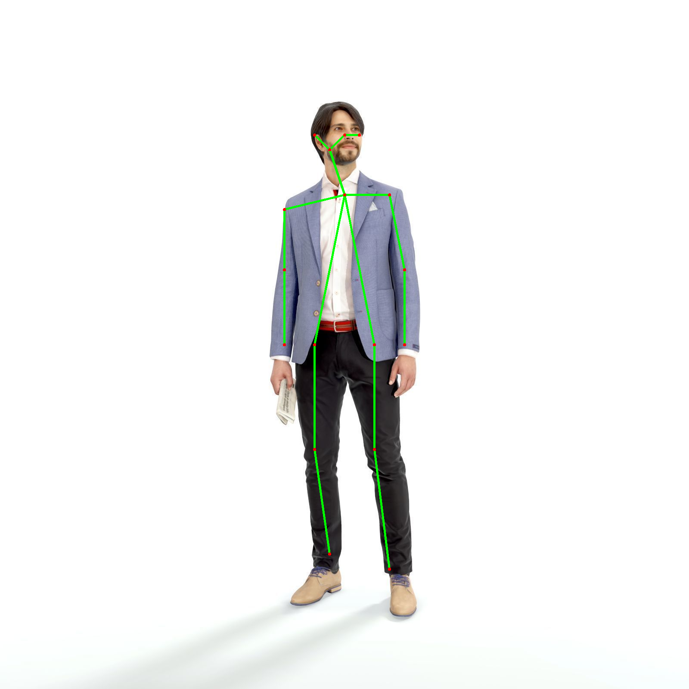

# Human Pose Estimation

Detects and draws human body keypoints (shoulders, elbows, knees and more) in images and video.

**Live browser demo:** https://remarkable-profiterole-f36b20.netlify.app/ (ml5.js PoseNet with p5.js, runs on your webcam; nothing is uploaded, inference happens in the browser)

## What is in this repository

| Path | What it is |
|---|---|
| `app/estimation_app.py` | Streamlit app: OpenCV DNN with a pre-trained OpenPose-style TensorFlow model. Upload an image, adjust the confidence threshold, see the detected skeleton. |
| `app/graph_opt.pb`, `app/stand.jpg` | The model file and the demo image the app falls back to |
| `index.html` | The browser demo (ml5.js PoseNet + p5.js). The Netlify demo is a deployment of this file. |
| `experiments/` | MediaPipe Pose scripts from the internship: one for a single image, one for webcam or video. `experiments/requirements.txt` pins the MediaPipe version they need. |
| `samples/output-image.png` | The OpenPose model's 18-point skeleton drawn on `app/stand.jpg` with OpenCV DNN |

## Run the Streamlit app

```bash
git clone https://github.com/Aditya-CodeCraft/Human-pose-estimation.git
cd Human-pose-estimation
pip install -r requirements.txt
streamlit run app/estimation_app.py
```

Upload a clear, full-body image, or use the bundled demo image, then move the threshold slider to control how confident a detection must be before it is drawn.

## Run the browser demo locally

Open `index.html` in a browser and allow camera access. Browsers only expose the camera to secure contexts (`https://` or `http://localhost`), and some block it on `file://` pages, so if nothing appears, serve the folder first:

```bash
python -m http.server 8000
```

and open http://localhost:8000/.

## Run the experiments

The experiments use MediaPipe's legacy `mp.solutions` API, which was dropped from the pip package after 0.10.21. That release has wheels for Python 3.9-3.12 only and needs `numpy<2` and `protobuf<5`, so install it in a separate environment from the Streamlit app:

```bash
pip install -r experiments/requirements.txt
python experiments/mediapipe_image_landmarks.py path/to/image.jpg   # single image, prints the 33 landmarks
python experiments/mediapipe_webcam_pose.py                          # webcam 0, press q to quit
python experiments/mediapipe_webcam_pose.py path/to/video.mp4        # a video file
```

## How it works

- **OpenCV app.** The image is resized to 368 x 368 and passed through the network, which outputs one heatmap per body part. Each heatmap is reduced to its most confident point; points below the slider threshold are dropped, and the remaining points are joined using a fixed list of limb pairs.
- **Browser demo.** ml5.js loads PoseNet in the browser and p5.js draws the 17 keypoints and the skeleton over the live camera frame on every draw call.
- **Experiments.** MediaPipe Pose returns 33 landmarks per frame with its own drawing utilities; the two scripts show the single-image and the streaming case.

## Sample output



## Testing notes

There is no automated test suite; the app and the browser demo were checked by hand. Issues found and fixed along the way:

- `index.html` contained literal Markdown code fences that rendered as text on the page.
- PNG uploads with an alpha channel gave the network a 4-channel array, which `blobFromImage` rejects; uploads are now converted to RGB first.
- The model and the demo image were loaded relative to the working directory, so `streamlit run` only worked from inside the app folder; they are now loaded relative to the file.
- The app used `st.cache`, which current Streamlit no longer provides, and the deprecated `use_column_width` image option; both were replaced.

Things to know when you try it:

- The OpenCV app takes the single most confident point of each heatmap, and the browser demo draws all 17 PoseNet keypoints without checking their scores, so a limb that is out of frame or hidden can still get a point drawn somewhere. Raising the confidence threshold in the OpenCV app suppresses these at the cost of dropping faint true detections.
- The browser demo runs PoseNet on the viewer's own machine, so frame rate depends on the device and browser.
- The OpenCV app keeps one point per body part, so it handles one person at a time; with several people in frame the keypoints get mixed between them. It expects a clear, full-body image.

## Tech stack

Python, OpenCV, MediaPipe, Streamlit, NumPy, ml5.js, p5.js

## Credits

- `graph_opt.pb` (MobileNet OpenPose TensorFlow graph) and the OpenCV DNN keypoint code follow the widely shared `openpose.py` from [quanhua92/human-pose-estimation-opencv](https://github.com/quanhua92/human-pose-estimation-opencv), itself adapted from OpenCV's `samples/dnn/openpose.py`. The Streamlit app around it was written during the AICTE internship.
- [ml5.js](https://ml5js.org/) and [p5.js](https://p5js.org/) for the browser demo (PoseNet); [MediaPipe](https://developers.google.com/mediapipe) for the experiments. Each keeps its own licence.

---

Built as part of an **AICTE internship** project.
